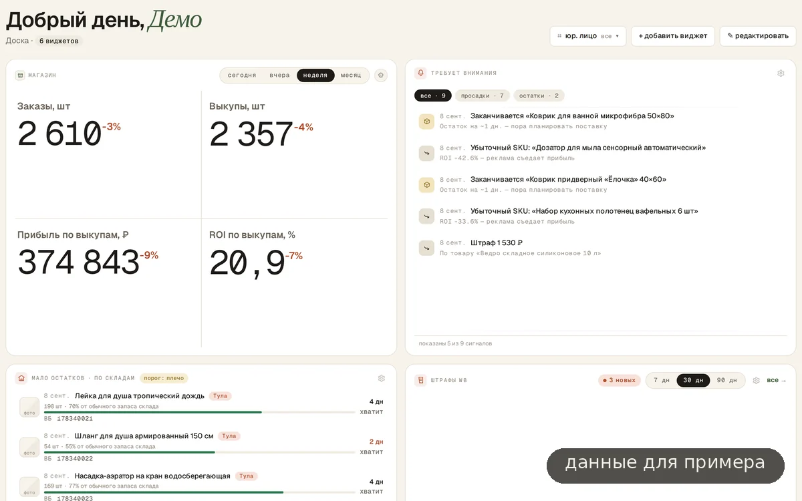
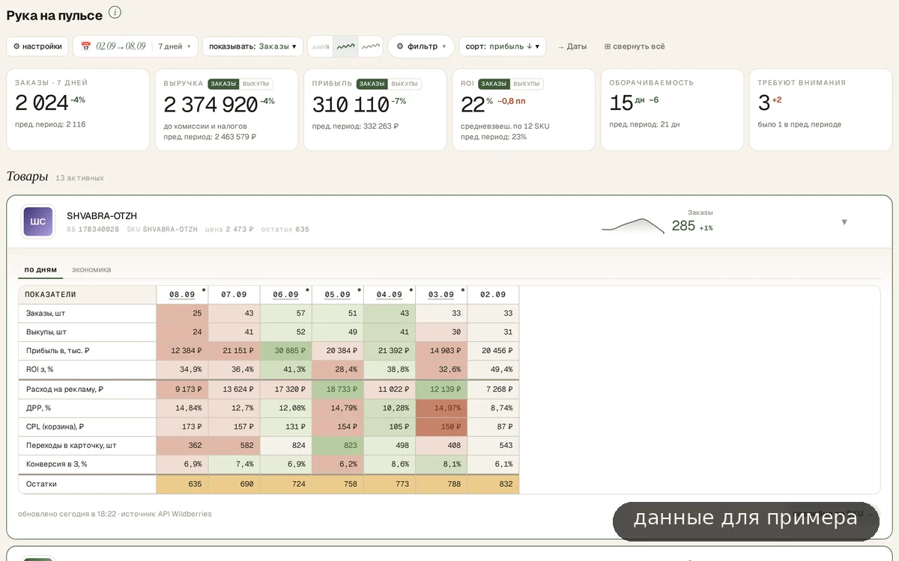
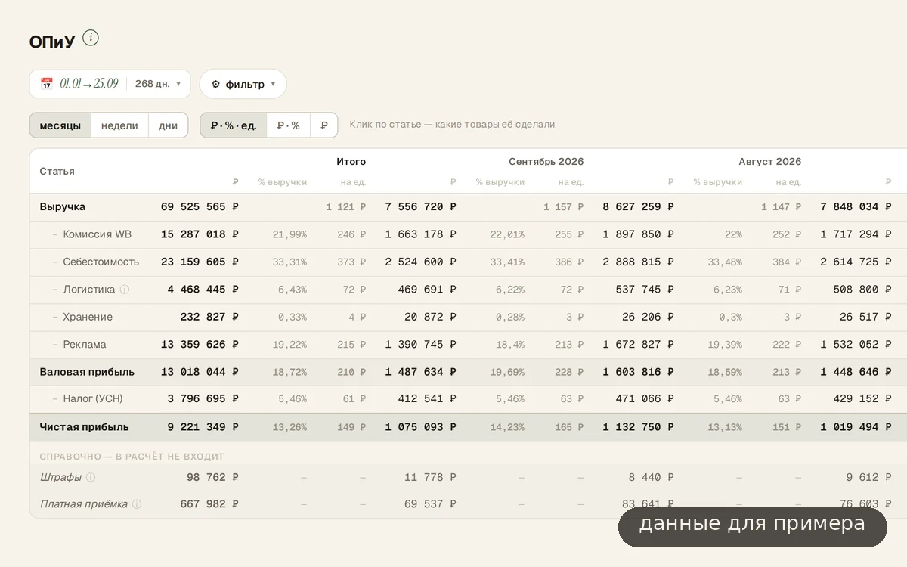
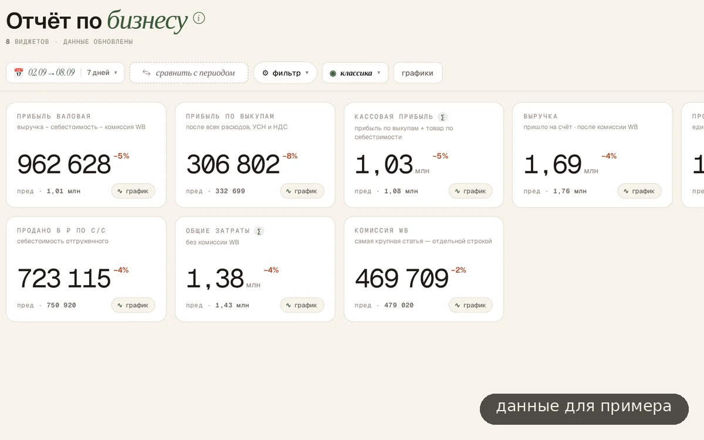
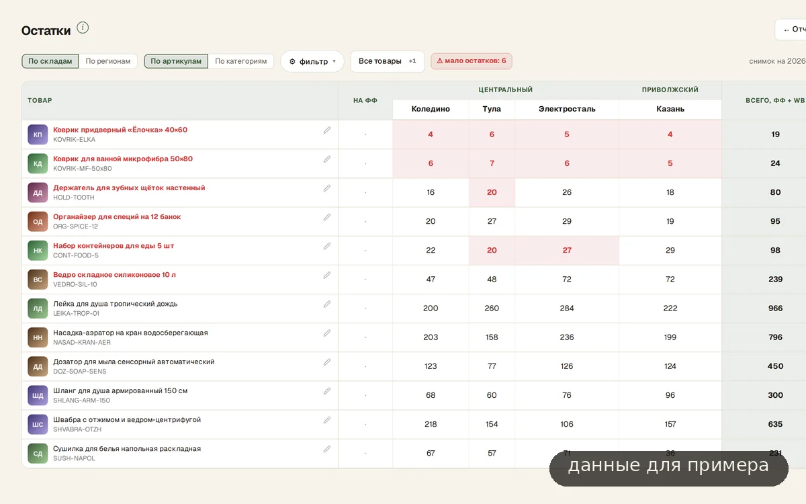
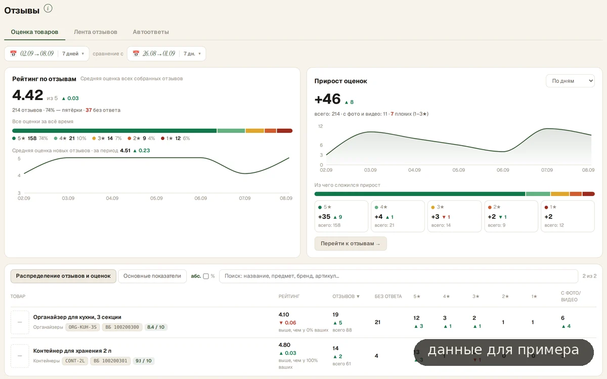

# WB Seller Platform

**SaaS для селлеров Wildberries и Ozon: аналитика, финансы, склад, реклама и автоматизация рутины.**
Работает в продакшене с реальными клиентами. Разработка идёт с мая 2026 года.

> Это коммерческий продукт с закрытым исходным кодом. Здесь — обзор проекта, скриншоты на демо-данных и учебный пример кода.

## Моя роль

Я автор проекта: продукт, архитектура, разработка, выкатка и поддержка.
Проект построен в связке с ИИ-агентами (Claude Code). Код пишут агенты, я руковожу:
- проектирую систему;
- ставлю задачи и принимаю решения;
- проверяю результат;
- отвечаю за работающий прод.

## Масштаб

| | |
|---|---|
| Коммитов | 2 800+ |
| Код | ~280 тыс. строк Python, ~230 тыс. строк TypeScript |
| API | 860+ эндпоинтов |
| База данных | PostgreSQL, ~590 таблиц, 300+ миграций |
| Тесты | ~9 600 автотестов |
| Фоновые процессы | 60+ задач по расписанию |

## Что умеет

- **Аналитика продаж:** заказы, выкупы, прибыль и ROI по каждому товару и дню, план-факт.
- **Финансы:** ОПиУ, отчёт по бизнесу, недельные сводки, учёт расходов.
- **Юнит-экономика** товара до закупки.
- **Склад и поставки:** остатки по складам, отгрузки, FBO и FBS, склад фулфилмента.
- **Реклама:** аналитика кампаний и управление ставками.
- **Покупатели:** отзывы, вопросы, чат, автоответы.
- **Уведомления** в Telegram и на почту.
- **Команда:** роли и права доступа, тарифы, партнёрская программа, админ-панель.

## Автоматизация

- Сбор данных из API Wildberries и Ozon по расписанию.
- Автоматический запуск и ведение рекламы новых товаров.
- Поиск товара для запуска: от анализа ниши до заказа поставщику, с использованием LLM.
- Отслеживание позиций товаров в поиске WB.
- Ежедневные сигналы и отчёты в Telegram.

## С чем приходилось работать

- Интеграции с API маркетплейсов: жёсткие лимиты, частые изменения и отключения методов.
- Изоляция данных клиентов в общей базе.
- Точность финансовых расчётов.
- Автоматика, которая распоряжается деньгами клиента, и её безопасность.
- Браузерная автоматизация.
- LLM в бизнес-процессах.
- Эксплуатация: тестовое и боевое окружения, миграции, мониторинг, разбор инцидентов.

## Стек

**Бэкенд:** Python, FastAPI, SQLAlchemy, Alembic, asyncio
**Данные:** PostgreSQL, Redis
**Фронтенд:** React, TypeScript, Vite
**Автоматизация:** systemd, Playwright, Telegram Bot API, LLM
**Инфраструктура:** Linux, nginx, Docker
**Разработка:** Claude Code (ИИ-агенты)

## Скриншоты

Демо-режим, данные синтетические.

| | |
|---|---|
|  Продажи по товарам и дням |  ОПиУ |
|  Отчёт по бизнесу |  Остатки по складам |

## Пример кода

[`postgres-rls-multitenant`](demos/postgres-rls-multitenant): учебный пример изоляции данных клиентов средствами PostgreSQL Row-Level Security, с тестами на настоящем Postgres в Docker. Написан с нуля для портфолио.
